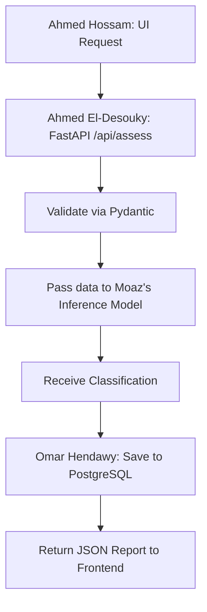
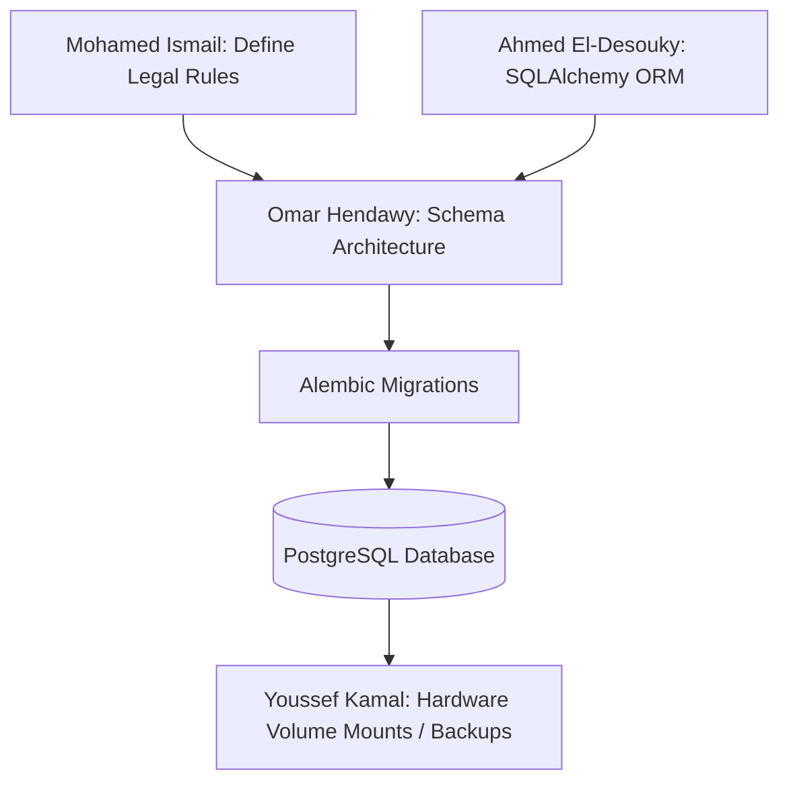
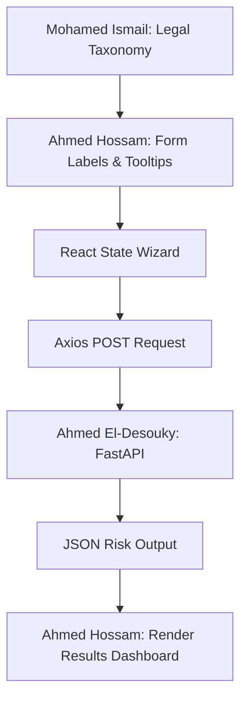
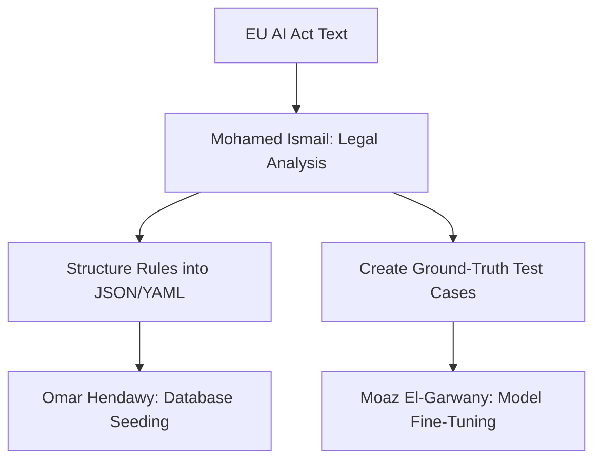
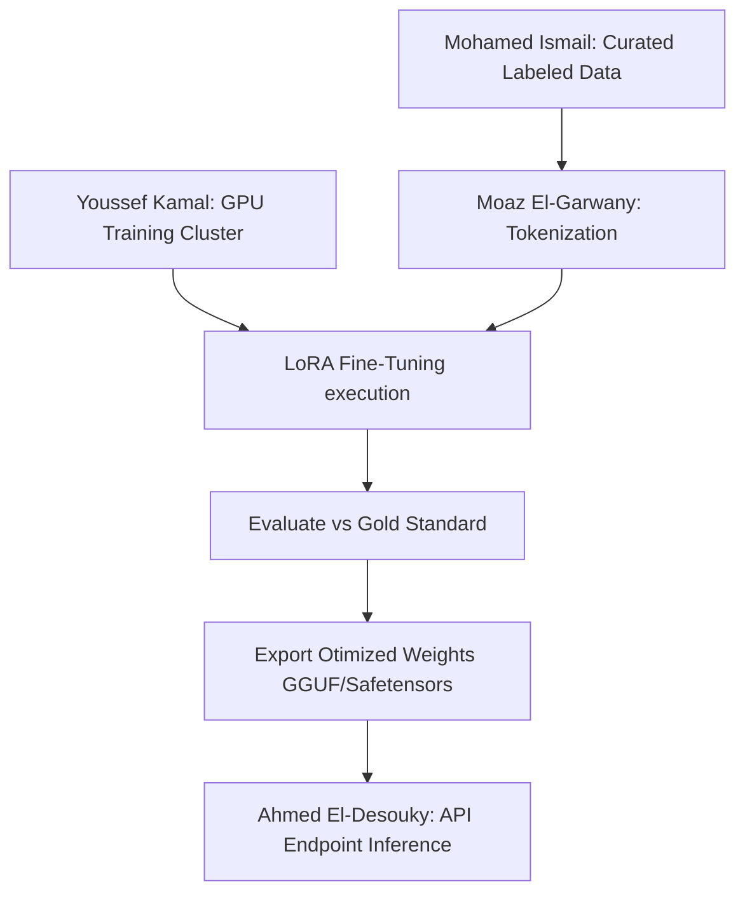
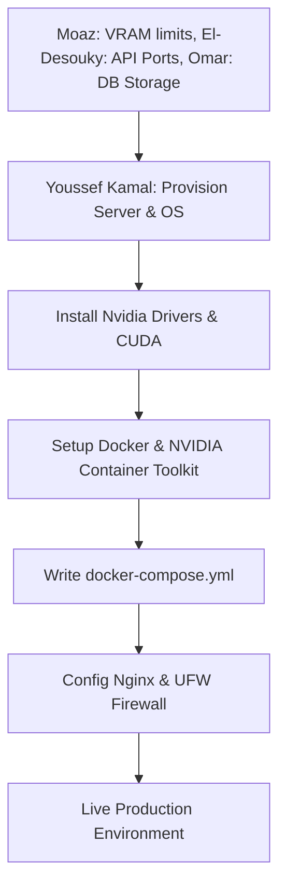

# EU AI Act Compliance Co-Pilot - MVP Master Plan

## Project Overview

**Goal:** Build a Minimum Viable Product (MVP) for an "EU AI Act Compliance Co-Pilot" that helps development teams assess their AI models against EU regulations to avoid severe fines. The MVP focuses strictly on core risk classification.
**Team Approach:** Cross-functional collaboration mapping Frontend, Backend, AI Training, Database, Legal Structuring, and Hardware requirements.

---

## 1. Ahmed El-Desouky - Backend & AI Development

### Role & Focus

Serve as the central orchestrator connecting the user-facing application frontend, the database, and the AI models using a robust API.

### Core Technologies

- **Framework:** FastAPI (Python), Uvicorn
- **Integration & Validation:** Pydantic
- **Database Connection:** SQLAlchemy (async ORM), `asyncpg`
- **Testing:** Postman / Insomnia

### Detailed Tasks

1. **API Initialization:** Structure the FastAPI application, set up CORS headers, and configure environment variables.
2. **Endpoint Construction:**
   - `POST /api/assess`: Receive JSON payloads (AI project details from the frontend), validate structure, and trigger inference.
   - `GET /api/reports/{id}`: Fetch stored compliance reports.
3. **AI Model Invocation API:** Build the internal wrapper using Python to load the inference pipeline (provided by Moaz), pass the user input, and parse the output (e.g., Risk Level: High, Low).
4. **Data Persistence Flow:** Execute database writes via SQLAlchemy to store the user input and the resulting AI assessment simultaneously into schemas built by Omar.

### Cross-Team Collaboration

- **With Moaz El-Garwany (AI Training):** Standardizing the tensor shapes or text prompt structures expected by the NLP model when wrapped inside an API endpoint.
- **With Omar Hendawy (Database):** Agreeing on the ORM class structures mapping to PostgreSQL tables.
- **With Ahmed Hossam (Frontend):** Defining the exact JSON DTOs (Data Transfer Objects) for the request payload and response body.
- **With Youssef Kamal (Hardware):** Ensuring the backend Docker container properly utilizes `nvidia-docker` runtime layers to expose GPUs to the Python process.

### Workflow Visualization

---

## 2. Omar Hendawy - Database Management

### Role & Focus

Architect, deploy, and ensure the performance and security of the relational entity storing all user contexts, system criteria, and assessment results.

### Core Technologies

- **Core Engine:** PostgreSQL 16+
- **Migrations:** Alembic
- **Monitoring:** pgAdmin, DBeaver

### Detailed Tasks

1. **Schema Design:** Draft a normalized data model prioritizing relational integrity.
   - `projects` table (inputs from user).
   - `assessments` table (outputs from AI).
   - `compliance_rules` table (legal lookups).
2. **Migration Pipeline Setup:** Configure Alembic to manage structural database changes methodically.
3. **Query Optimization:** Establish necessary indexing strategies before scaling to guarantee high-performance reads for reporting.
4. **Backup Implementation:** Create shell scripts/cron jobs for automated daily SQL dumps.

### Cross-Team Collaboration

- **With Ahmed El-Desouky (Backend):** Harmonizing the raw SQL schema structure with El-Desouky's SQLAlchemy ORM models. Providing connection strings and credentials securely.
- **With Mohamed Ismail (DB Integration/Research):** Determining exactly what data types (e.g., JSONB, Enums, TEXT) best represent the complex, hierarchical legal rules Ismail extracts from the EU AI Act.
- **With Youssef Kamal (Hardware):** Defining volume mounts inside `docker-compose.yml` to ensure data persists reliably on the physical storage device and is isolated from the ephemeral containers.

### Workflow Visualization

---

## 3. Ahmed Hossam - Frontend Development

### Role & Focus

Build a high-performance, intuitive interface guiding users through complex compliance assessments seamlessly.

### Core Technologies

- **Framework:** React.js 18+
- **Styling:** Tailwind CSS
- **Build Tool:** Vite
- **Data Fetching:** Axios or React Query

### Detailed Tasks

1. **Component Scaffolding:** Set up the Vite + React boilerplate and establish the Tailwind theme architecture (colors, typography).
2. **Assessment Form Wizard:** Create a responsive, stateful multi-step form to collect technical inputs (data scope, models used, deployment context).
3. **API Integration Module:** Implement standard methods to POST form data to the backend API and handle asynchronous state (loading spinners, error modals, success states).
4. **Compliance Dashboard:** Build the results view to present the final risk classification visually (e.g., Red for Unacceptable, Yellow for High Risk) including actionable remediation insights.

### Cross-Team Collaboration

- **With Ahmed El-Desouky (Backend):** Negotiating the exact shape of the REST APIs, error code meanings, and HTTP methods. Receiving and mocking sample JSON responses before the backend is fully operational.
- **With Mohamed Ismail (DB Integration/Research):** Interpreting the legal taxonomy to ensure the form input labels and tooltips accurately reflect the legal definitions of the EU AI Act.

### Workflow Visualization

---

## 4. Mohamed Ismail - Database Integration & Compliance Research

### Role & Focus

Act as the semantic bridge extracting legal logic from the EU AI Act and transforming it into structured intelligence that the technical teams can utilize.

### Core Technologies

- **Analysis:** Official EU AI Act Documentation
- **Structuring:** JSON, YAML conventions
- **Scripting:** Python (for data seeding tools), SQL

### Detailed Tasks

1. **Risk Tier Definition Formulation:** Map out the definitive criteria separating Unacceptable Risk, High Risk, Limited Risk, and Minimal Risk based on specific Title and Annex references.
2. **Codification into Data Objects:** Translate the qualitative legal text into structured deterministic rules (JSON/YAML formats) that can act as hard-coded logic paths or lookup trees.
3. **Database Pre-seeding:** Write automation scripts that insert these structured rules into Omar Hendawy's `compliance_rules` tables.
4. **Test Case Generation:** Design a matrix of hypothetical, edge-case AI project descriptions mapped to their correct legal outcome. This serves as the "Gold Standard" test set.

### Cross-Team Collaboration

- **With Moaz El-Garwany (AI Training):** Supplying Moaz with the precise training data (the test cases and qualitative definitions) necessary to teach the NLP model how to classify text inputs accurately against the law.
- **With Omar Hendawy (Database):** Designing the database schema layout capable of holding nested, hierarchical legal statutes.
- **With Ahmed Hossam (Frontend):** Ensuring the wording used on the UI input forms correctly matches the legal definitions without causing user confusion.

### Workflow Visualization

---

## 5. Moaz El-Garwany - AI Training & NLP Models

### Role & Focus

Develop the core intelligence engine that analyzes natural language descriptions of user AI systems and classifies their regulatory risk tier.

### Core Technologies

- **Libraries:** PyTorch, Hugging Face Transformers
- **Optimization:** PEFT (LoRA), BitsAndBytes (8-bit/4-bit quantization)
- **Environment:** Jupyter Notebooks, Python

### Detailed Tasks

1. **Pre-Trained Pipeline Selection:** Identify an efficient, capable open-weights LLM (e.g., Llama-3-8B-Instruct) suitable for multi-class categorization.
2. **Dataset Curation & Prep:** Tokenize and format the labeled dataset provided by Mohamed Ismail into a conversational prompt structure.
3. **Fine-tuning Execution:** Run the LoRA training loop focused purely on the classification task, prioritizing accuracy explicitly against High/Unacceptable risk false-negatives.
4. **Model Exportation:** Export the trained adapters, merge them with the base model, and optimize the weights (quantization) so it can fit within the strict VRAM constraints of the production server.

### Cross-Team Collaboration

- **With Mohamed Ismail (DB Integration/Research):** Iterating rapidly on the training data. If the model misclassifies certain categories, requesting more nuanced dataset examples from Ismail.
- **With Ahmed El-Desouky (Backend):** Delivering the final inference script (e.g., `predict.py`) and model artifacts, ensuring the backend can initialize the model in memory efficiently when Uvicorn boots.
- **With Youssef Kamal (Hardware):** Profiling the model's VRAM usage and communicating exact CUDA toolkit constraints to Youssef.

### Workflow Visualization

---

## 6. Youssef Kamal - Hardware & Infrastructure

### Role & Focus

Design, provision, and secure the physical and network infrastructure capable of running complex AI inferences, databases, and APIs reliably.

### Core Technologies

- **Operating System:** Ubuntu Server (Linux)
- **Hardware Drivers:** NVIDIA Data Center Drivers, CUDA Toolkit
- **Orchestration:** Docker Engine, Docker Compose, `nvidia-docker`
- **Networking:** Nginx (Reverse Proxy), UFW (Firewall)

### Detailed Tasks

1. **GPU Server Provisioning:** Architect a machine with adequate hardware specifications (e.g., RTX 4090/A10G, ample RAM, NVMe storage) to meet the demands of the LLM inference.
2. **Environment Configuration:** Install the strictly required OS level libraries, proprietary Nvidia drivers, and the exact version of the CUDA toolkit requested by the AI team.
3. **Docker Architecture:** Construct the master `docker-compose.yml` that networks the Postgres database, the FastAPI backend (with GPU passthrough enabled), and the React frontend into isolated but communicative containers.
4. **Security & Routing:** Implement UFW rules to restrict direct port access and configure Nginx to handle incoming traffic, terminating SSL and routing requests to the appropriate internal Docker ports.

### Cross-Team Collaboration

- **With Moaz El-Garwany (AI Training):** Determining the exact VRAM overhead the AI model will demand in production. Confirming CUDA toolkit compatibility.
- **With Ahmed El-Desouky (Backend):** Assisting in building the final backend Docker Image, mapping specific local directories to container volume mounts, and passing `.env` configurations.
- **With Omar Hendawy (Database):** Configuring persistent local storage mapping for the PostgreSQL Docker container, ensuring data survives container restarts.

### Workflow Visualization

