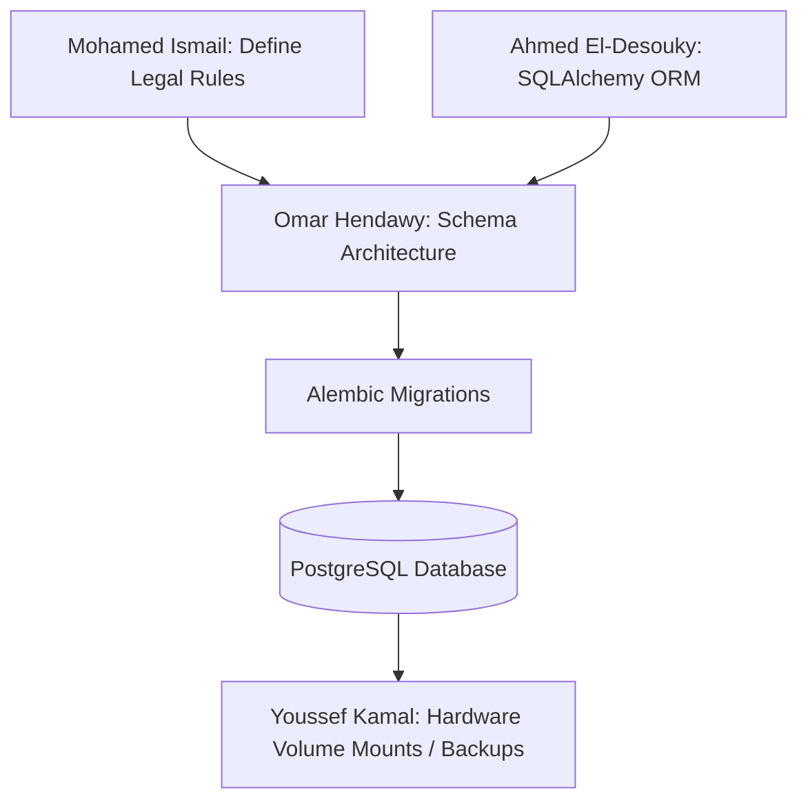

# Omar Hendawy - Database Management

## Role & Focus

Architect, deploy, and ensure the performance and security of the relational entity storing all user contexts, system criteria, and assessment results.

## Core Technologies

- **Core Engine:** PostgreSQL 16+
- **Migrations:** Alembic
- **Monitoring:** pgAdmin, DBeaver

## Detailed Tasks

1. **Schema Design:** Draft a normalized data model prioritizing relational integrity.
   - `projects` table (inputs from user).
   - `assessments` table (outputs from AI).
   - `compliance_rules` table (legal lookups).
2. **Migration Pipeline Setup:** Configure Alembic to manage structural database changes methodically.
3. **Query Optimization:** Establish necessary indexing strategies before scaling to guarantee high-performance reads for reporting.
4. **Backup Implementation:** Create shell scripts/cron jobs for automated daily SQL dumps.

## Cross-Team Collaboration

- **With Ahmed El-Desouky (Backend):** Harmonizing the raw SQL schema structure with El-Desouky's SQLAlchemy ORM models. Providing connection strings and credentials securely.
- **With Mohamed Ismail (DB Integration/Research):** Determining exactly what data types (e.g., JSONB, Enums, TEXT) best represent the complex, hierarchical legal rules Ismail extracts from the EU AI Act.
- **With Youssef Kamal (Hardware):** Defining volume mounts inside `docker-compose.yml` to ensure data persists reliably on the physical storage device and is isolated from the ephemeral containers.

## Workflow Visualization

